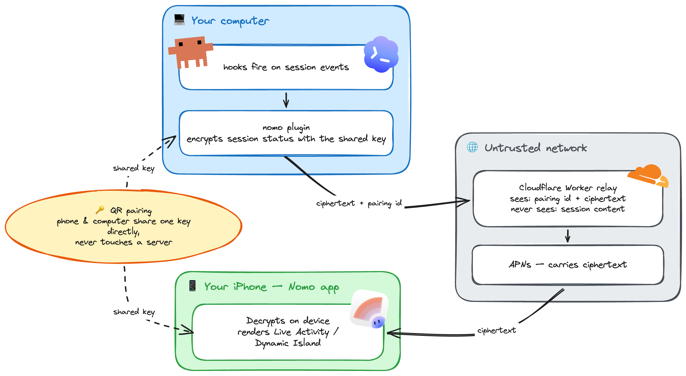

<p align="center"></p>

# Nomo — Live Activity on your iPhone

<p align="center">
&nbsp;&nbsp;
&nbsp;&nbsp;
<picture><source media="(prefers-color-scheme: dark)" srcset="assets/opencode-dark.png"></picture>&nbsp;&nbsp;
<picture><source media="(prefers-color-scheme: dark)" srcset="assets/cursor-dark.png"></picture>&nbsp;&nbsp;

</p>

<p align="center">
<a href="https://apps.apple.com/app/nomo-ai-status-usage/id6779366830"></a>
</p>

Mirror your **Claude Code**, **OpenAI Codex**, **OpenCode** and **Cursor** session milestones to
the **Nomo iPhone app** as a Live Activity (Dynamic Island). A session's status — working,
needs-your-approval, done — shows up on your phone in real time, so you can step away from the
terminal and still know when an agent needs you or has finished. When a Claude Code, Codex or
OpenCode session stops for a permission prompt or a question, you can **answer it from the phone** —
tap Allow/Deny or pick an option and the session carries on without you at the keyboard (Cursor is
status-only). Works with **Codex** in the terminal and the **Codex desktop app** alike.

Everything is **end-to-end encrypted**. Pairing is a single QR-code scan (or a short typed code);
there is no server key to copy. All session content (titles, machine name, status, even *which* agent
produced an event) rides **inside** an encrypted blob, so the relay Worker that fans out the APNs
push is a blind relay and never sees plaintext. **One pairing covers every agent** on a machine —
Claude Code, Codex, OpenCode and Cursor share the same credentials, encryption key, watchdog, and
Live Activity.

> [!NOTE]
> **This README is the contributor and security view** — how it's built, how it's wired, and what
> the crypto actually guarantees. The user guide (pairing walkthrough, command reference,
> per-agent differences, troubleshooting) lives at **[docs.nomo.gg](https://docs.nomo.gg)**.

> [!NOTE]
> **Platforms:** developed and tested on **macOS** and **Linux**. **Windows is untested** — it may
> work (the hooks are pure Node built-ins), but nothing on Windows has been verified, so treat it as
> unsupported for now.

The PC side ships as **four integrations over one shared `plugin/` directory**: a **Claude Code
plugin** (`nomo-cc`), a **native Codex plugin** (`nomo`), an **OpenCode plugin module**, and a
**Cursor hook** merged into Cursor's `hooks.json`. Claude Code, Codex and Cursor run the same kind of
self-contained `.mjs` hooks, the liveness watchdog, and the interactive commands as single-file
artifacts that run under **either bun or node ≥ 18** (a `run.sh` shim picks whichever is installed);
OpenCode instead loads one resident `.js` bundle inside its own server process. There are **zero
npm dependencies** — Node built-ins only.

## Architecture — end-to-end encrypted

Pairing establishes **one shared key** that only your phone and computer ever hold — no server
sees it. There are two ways to hand it over, and both keep the key off every server:

- **Scan the QR** on the pairing page. The QR carries a random pairing secret that rides only in the
  code image; the phone mixes it with its own nonce (HKDF-SHA256) to derive the shared key.
- **Type the one-time code** — six words and a short channel number (e.g.
  `7-ocean-sunset-mango-river-atlas-cabin`). The phone runs PBKDF2-SHA256 over the six words to
  reconstruct the same secret, then the same HKDF step, arriving at the identical key. The words never
  leave the pairing page; the channel is only a one-time routing handle the phone redeems once (it
  burns on first use and expires in 10 minutes).

Either way, the plugin encrypts every session update with the derived key **before** anything leaves
your machine, so the relay Worker and Apple's push service only ever carry ciphertext. Decryption
happens on your iPhone.

<picture>
  <source media="(prefers-color-scheme: dark)" srcset="assets/architecture-dark.png">
  
</picture>

<sub>Diagram source: [`assets/architecture.excalidraw`](assets/architecture.excalidraw) — open it at [excalidraw.com](https://excalidraw.com) to edit.</sub>

**Plaintext — titles, machine name, status, even which agent produced the event — never leaves
your computer except end-to-end encrypted.** The Worker is a blind fan-out relay: it can route by
pairing id but cannot read a single field of what it forwards.

### The code is never printed

By default the one-time pairing code is shown **only on the pairing page**, behind a "Tap to reveal
code" control — it is never printed to the terminal, so it cannot end up in shell history, a screen
recording, or an AI assistant's transcript. `pair.mjs --show-code` (`/nomo-cc:pair code`,
`$nomo-pair code`, `/nomo-pair code`) is the deliberate opt-out for a headless or SSH-only box: it
skips the page and prints the code to stdout, where it is sensitive for the ~10 minutes it is valid.
When a browser is available at all, prefer the page — scanning the QR never touches a keyboard, a
terminal, or a chat transcript. Walkthrough: [docs.nomo.gg/setup/pairing](https://docs.nomo.gg/setup/pairing).

## Encryption

In plain English:

- **Every session update is sealed with AES-256-GCM** before it leaves your machine. The relay Worker
  and Apple's push service only ever carry ciphertext — they can route it by pairing id but can't read
  a single field (title, machine name, status, or which agent produced it). The relay is **blind**:
  the only things that transit it in the clear are *public* keys.
- **The typeable code is six BIP39 words (~66 bits of entropy)**, stretched with **PBKDF2-SHA256 at
  600,000 iterations**. Six words (up from four) puts an offline brute-force — the attack a
  logging/compromised relay could try against the known-plaintext pairing blob — out of reach.
- **A per-pairing ephemeral ECDH (P-256) "ratchet" derives the durable key.** The code (or the
  scanned QR secret) only bootstraps a one-time handshake key; your computer and phone each generate a
  throwaway keypair, do an ECDH, and mix the result with that bootstrap key to produce the key that
  actually encrypts your sessions. The throwaway private keys are discarded right after pairing. This
  gives **forward secrecy**: a code revealed *after* you've paired — leaked into a screen recording, a
  shell history, or an AI transcript — **can't decrypt your sessions**, because the ephemeral private
  keys it would need are already gone. Mixing the code into the handshake also stops a relay from
  quietly swapping the public keys (a man-in-the-middle): if it tampers, pairing fails instead of
  silently succeeding under the attacker's key.

## Cloud handoff — security

`/nomo-cc:handoff` moves a Claude Code session to your own cloud box, and `/nomo-cc:back` brings it
home. What that does and doesn't expose:

- **Your Claude login never leaves the Mac.** The box gets none of your Claude subscription
  credentials: `~/.claude.json`, `.credentials.json`, your settings `env`, `~/.ssh`, `~/.aws`,
  `~/.gnupg` and the Keychain are never packed (`SENSITIVE` in `src/entries/handoff.ts`). The box
  runs Claude Code on API billing through its own OpenRouter key, never your subscription.
- **Keys never touch argv, tmux or the box's disk.** The API keys reach the box only as the
  environment of the setup command, which writes them to a 0600 file on `/dev/shm` (RAM); the
  launcher deletes that file as it reads it. They are never passed on a command line or with
  `tmux -e`, so `ps` on the box never shows them. Your Nomo pairing never travels either.
- **Secret-looking files stay home — unless git tracks them.** The working tree travels as a git
  bundle of `HEAD`, the uncommitted diff, and a tar of untracked files. Every file whose name looks
  like a secret (`isSecretName`: `.env*`, `.dev.vars`, `.npmrc`, `.netrc`, private keys,
  `credentials.json`, `secrets.*`…) is dropped from that tar. A secret git *tracks* is in the bundle
  and does travel: the `Cloud check:` block warns about it by name. That check only lists file
  names; it never opens a secret file.
- **Secrets already in the conversation are flagged before they travel.** The transcript, its
  subagent transcripts and project memory go to the box unedited, so a `.env` a session read or a key
  it printed would go too. Before anything is parked, `/nomo-cc:handoff` scans exactly those files
  (`src/core/transcript-scan.ts`) for key-shaped strings: OpenAI/Anthropic `sk-…`, GitHub
  `ghp_`/`gho_`/`ghu_`/`ghs_`/`ghr_`/`github_pat_`, AWS `AKIA`/`ASIA`, Slack `xox[bpas]-`, Google
  `AIza…`, Stripe `sk_live_`/`rk_live_`, PEM private-key headers, JWTs (the header must decode to JSON
  with `alg`), and upper-case `…KEY=`/`…SECRET=`/`…TOKEN=`/`…PASSWORD=` assignments whose value is
  16+ characters, mixes letters and digits and has high Shannon entropy. On a hit it prints the kinds,
  counts and line numbers in the `Cloud check:` block and starts nothing; `/nomo-cc:handoff anyway`
  is the explicit confirm. *Move to cloud* from the phone refuses instead (`cloudWhy: "transcriptSecret"`). The
  scan never returns, logs or prints a matched value, not even part of one. It skips obvious
  placeholders (`xxx`, `your-key-here`, `<…>`, `example`…) and anything embedded in a longer base64
  run (Nomo's own sealed blobs, images). **It is pattern-based, so it is a seatbelt, not a
  guarantee:** it misses passwords and keys without a known prefix unless they sit in a `NAME=value`
  line, short or low-entropy values, secrets split across lines or encoded, and anything the rest of
  the turn prints after the command ran. It can also flag a test or revoked key.
- **The box is its own paired computer.** It pairs with your phone under its own keys ("Nomo Cloud"),
  so phone ↔ box traffic is end-to-end sealed exactly like your Mac's, and the relay stays blind:
  it sees ids and flags (op, priority, a `parked` boolean), never titles or content.
- **Phone commands** (*Bring back*, *Move to cloud*) are sealed by the phone with the pairing key
  (AES-256-GCM). That seal is what makes them phone-only: the relay carries an opaque blob and
  cannot forge, read or alter one. The plugin checks each one itself: an allow-listed kind and a
  sealed timestamp no older than 120 s. Its nonce is single-use while the watchdog runs; the list
  of seen nonces is kept in memory and resets when the watchdog restarts, so after a restart only
  the 120 s expiry bounds a replay. A command acts only on a session in the right state: *Bring
  back* needs a session parked in the cloud, *Move to cloud* one that is not parked and not already
  in the cloud.
- **Move to cloud** carries no text at all: `{kind, sessionId, ts, nonce}`, anything else dropped;
  the box gets the default "continue" message. It runs only for a live, interactive Claude Code
  session (not Codex, OpenCode, a headless run or the desktop app), only once this Mac has paired
  its box from an interactive terminal handoff (cloud.json `pairedTo`; the QR is never shown from
  the background). It refuses outright when any file git tracks in the project's repo (`git ls-files`,
  dot-folders included) has a secret-looking name, and when git can't list them; a folder that is
  not a git repo has nothing tracked and may move.

**Not covered:** whoever holds your unlocked phone, or this computer's pairing key, can move a
session to *your own* box or bring one back, just as they could answer its remote approvals.

## Install — one command

```sh
bunx nomo-ai     # or: npx nomo-ai
```

It detects which of Claude Code, Codex, OpenCode and Cursor are on this machine, shows exactly what
it will run for each, and lets you toggle the list before anything happens. Then it drives **each
host's own install path** — the same four flows spelled out below — and prints the restart-and-pair
step for each one it installed.

It is a **bootstrapper, not a package manager**: it never writes into `~/.claude` or `~/.codex`
itself, because those hosts own install *and* update through their marketplaces, and a second writer
racing `claude plugin update` is how you end up with two versions fighting over one watchdog daemon.
There is deliberately **no `postinstall` hook** — a package that edits your agent config just because
you `npm install`ed it is the shape you should distrust. It only does something when you run it.

It never pairs your phone. Pairing stays the deliberate step you run from inside the agent
afterwards.

For scripting and CI:

| Flag | |
|---|---|
| `--claude` `--codex` `--opencode` `--cursor` | install exactly these — naming any one of them skips the prompt |
| `--all` | all four, detected or not — except Cursor, which is skipped with a note when it is not on this machine (name `--cursor` to try anyway) |
| `-y`, `--yes` | no prompt; install everything detected |
| `-n`, `--dry-run` | print the commands, run nothing |
| `--ref <branch\|tag>` | **OpenCode and Cursor only** — install from that ref instead of the default branch |
| `-h`, `--help` / `-v`, `--version` | |

With no flags and no terminal to ask, it refuses rather than guessing. Every failure names the step,
the exit code, and the command to run by hand; the exit status is non-zero if any agent failed.

The OpenCode leg clones this repo to `~/.nomo` and runs `plugin/scripts/opencode-install.sh` from
there — the same thing you would do by hand below. It has to be a durable checkout, not the npm
tarball: the installed stub re-exports an absolute path, and a `bunx` cache directory does not survive
the week.

**It updates as well as installs**, and the two clone-based legs do it for you. An agent that already
has Nomo shows an update in the plan instead of an install. For OpenCode and Cursor that update really
runs — neither host has an update path for Nomo, so the `~/.nomo` checkout is the version. OpenCode's
`~/.nomo` is fetched, compared and pulled by the same code `/nomo-update` uses; Cursor's is
fast-forwarded (`git pull --ff-only`) and `cursor-install.mjs` re-run to refresh `hooks.json` and the
skills. For Claude Code the row **prints** the host's own command and runs nothing:

```sh
claude plugin update nomo-cc@nomo
```

Claude Code does auto-update plugins, but per-marketplace behind an `autoUpdate` flag that defaults
**on** for Anthropic-official marketplaces and **off** for third-party and local ones. Nomo is
third-party, so that command is the only thing that moves your install.

**Codex has no update verb at all** — `codex plugin` is add/list/marketplace/remove — so its row is
gated on how the marketplace was added, which `~/.codex/config.toml` records as `source_type`:

| `source_type` | what an update is | the row |
| --- | --- | --- |
| `local` | Codex reads the plugin **live from the path**; a `git pull` there is the whole update | prints no command — there is nothing to run |
| `git` | Codex holds a snapshot, and refreshing it *is* the plugin update | `codex plugin marketplace upgrade <marketplace>` |
| missing / unreadable | unknown | prints no command |

Every marketplace Codex ships with is local, so "nothing to run" is the common case, not the corner
one. A printed no-op is worse than a missing line: one is invisible, the other sends you chasing it.

The asymmetry is deliberate. Both hosts already update in one command you own, so running it for you
buys almost nothing — and install begins with `marketplace add`, which would silently repoint a
marketplace you had aimed somewhere else (a local checkout, a fork) and send every later update to the
wrong place. Repointing a marketplace is install-time behaviour; it has no business in an update.

`--ref` exists for testing a branch or tag before it merges, and it reaches **two legs**: the
`~/.nomo` checkout that OpenCode and Cursor share is the only thing the installer owns. `claude plugin
marketplace add` and `codex plugin marketplace add` take an owner/repo and read the default branch —
there is no ref to hand them — so the installer says so out loud when you combine `--ref` with those
legs rather than implying it pinned all four. A `--ref` checkout is left **detached** on purpose:
that is how a later plain `bunx nomo-ai` recognises a pin and refuses to quietly fast-forward it
back (delete `~/.nomo`, or pass `--ref` again, to move it).

##  Install — Claude Code

From inside Claude Code:

```
/plugin marketplace add KarrixLee/nomo
/plugin install nomo-cc@nomo
```

Restart Claude Code so the hooks load, then pair this machine with your phone:

```
/nomo-cc:pair
```

It opens a browser page with a QR code; scan it from the Nomo app's **Sessions** tab
(**Pair a Computer**). Once it reports `Paired with … ✓` this machine's sessions appear in the app.

Five commands, all namespaced `nomo-cc:` — `pair`, `status`, `approvals`, `reset`, `unpair`
([reference](https://docs.nomo.gg/sessions/commands)).

The lifecycle hooks (`SessionStart`, `UserPromptSubmit`, `PreToolUse`, `PostToolUse`,
`Notification`, `PermissionRequest`, `Stop`, `SessionEnd`, `StopFailure`, `PostToolUseFailure`,
`PreCompact`, `PostCompact`, `Elicitation`, `ElicitationResult`) are wired automatically by the
plugin — no `settings.json` edits. The hook is deliberately silent: no pairing → no-op; network down
→ 2 s timeout, exit 0. It cannot affect a Claude Code session. A `start`/`update` POST the timeout
cuts off marks the session record `updatePending`; the watchdog's next 5 s sweep re-sends the
record's current state with a 5 s POST timeout, backing off 5 s → 60 s after a failure and holding
back while an approval hold is live.

##  Install — OpenAI Codex

Codex (**≥ 0.142**) ships a native plugin system, so Nomo installs as a standalone Codex plugin
(also named `nomo`, sharing the same `plugin/` directory as the Claude manifest). No Claude Code
required. From inside a Codex session — or the **Codex desktop app**'s built-in terminal:

```
codex plugin marketplace add KarrixLee/nomo
codex plugin add nomo@nomo
```

Then **trust the hooks once**: run `/hooks` and trust the **ten Nomo entries**. They ship with the
plugin (`plugin/hooks/codex-hooks.json`) but stay **inert until trusted** — this is Codex's own
safety gate, which Nomo cannot pre-approve. Skipping it leaves the plugin installed and silently
doing nothing. The hook command lines are byte-stable across releases, so trusting once holds
through updates (only a changed hook line re-arms the review).

Pair with `$nomo-pair`; the other four skills are `$nomo-status`, `$nomo-approvals`, `$nomo-reset`,
`$nomo-unpair` ([reference](https://docs.nomo.gg/sessions/commands)). There is **no separate Codex
pairing** — the hooks and skills read the same `~/.config/cc-status/config.json`, so they stay inert
(exit 0) until pairing completes. On the wire the only difference from Claude Code is that Codex's
encrypted blob is tagged `agent: "codex"`, so the phone can brand it.

Codex `request_user_input` questions additionally need the Codex task and the Nomo watchdog to share
one app-server process — see [docs.nomo.gg/sessions/codex](https://docs.nomo.gg/sessions/codex).

## <picture><source media="(prefers-color-scheme: dark)" srcset="assets/opencode-dark.png"></picture> Install — OpenCode

OpenCode has no marketplace and no hooks: it loads **one resident plugin module** inside its own
server process, auto-discovering `{plugin,plugins}/*.{ts,js}` in its config directories. So the
install is a clone plus **one command** — no `opencode plugin` command, and deliberately **no
npm-resolved plugin**: OpenCode's `Npm.add` short-circuits on an existing cache directory, so a bare
spec resolves `@latest` exactly once and never updates again. (`bunx nomo-ai` automates the clone
below; it hands OpenCode a filesystem path, never a package spec.)

Already installed Nomo for Claude Code or Codex? Reuse that copy — `claude plugin list` /
`codex plugin list` prints its path. Otherwise clone the repo anywhere:

```sh
git clone https://github.com/KarrixLee/nomo.git ~/.nomo
~/.nomo/plugin/scripts/opencode-install.sh
```

That is the whole install. The script resolves its own location, so there is no path to look up and
nothing to hand-edit. It writes two things and prints exactly what it wrote:

- `~/.config/opencode/plugins/nomo.js` — a one-line stub re-exporting `<checkout>/plugin/dist/opencode.js`.
- `~/.config/opencode/commands/nomo-*.md` — the six slash commands, with the plugin path baked in.

Re-running it is safe and idempotent; run it again if you move the checkout. It refuses to overwrite
a same-named file it did not write (pass `--force` to override), and `--project` installs into
`./.opencode/` for one repo instead of globally.

**Restart OpenCode** — plugins are imported once at server start; there is no hot reload.

The stub is a **re-export, not a copy**: the bundle keeps executing from `plugin/dist/`, where it can
find its sibling `cc-watchdog.mjs`. OpenCode auto-discovers the directory, so there is nothing to add
to `opencode.json`.

The six commands are the same ones Claude Code and Codex ship, minus the namespace — OpenCode command
names are flat and global, so they are `/nomo-pair`, `/nomo-status`, `/nomo-approvals`,
`/nomo-reset`, `/nomo-unpair` ([reference](https://docs.nomo.gg/sessions/commands)) — plus
`/nomo-update`, which those two do not need.

### Updating — `/nomo-update`

```
/nomo-update
```

Then restart OpenCode. That is the whole thing.

It checks before it changes anything: fetch, read the target version straight off the remote
(`git show <upstream>:plugin/.claude-plugin/plugin.json` — nothing is checked out), compare. Already
current prints `Already on 2.1.21 — nothing to do.` and stops — no pull, no reinstall, and no restart
advice for a restart that would change nothing. Behind prints the delta (`2.1.21 → 2.1.23`) **before**
pulling, fast-forwards, and re-runs the installer so a new `/nomo-*` command appears and the stub is
refreshed.

It refuses, loudly and specifically, rather than guessing: a checkout pinned to a branch or tag by
`bunx nomo-ai --ref` (deliberately detached — fast-forwarding it would silently un-pin someone testing
a branch), a dirty tree, no upstream, a diverged history, an unreachable remote, and a stub whose
checkout has been moved or deleted. Every refusal names the command to run by hand.

**The mechanism, for the curious.** OpenCode has no marketplace and no `plugin update`, so the
*checkout is the version* — `~/.config/opencode/plugins/nomo.js` is a one-line re-export of an
absolute `<checkout>/plugin/dist/opencode.js`, and updating means pulling that checkout and re-running
the installer. `/nomo-update` reads its own path back out of that stub, which is why it updates the
copy OpenCode actually imports rather than whichever one the command file was installed from. Doing it
by hand is still exactly `git -C <checkout> pull --ff-only && <checkout>/plugin/scripts/opencode-install.sh`.

**Pairing is shared, and `/nomo-pair` also works standalone.** The plugin reads the same
`~/.config/cc-status/config.json` as the other agents, so if you already paired with
`/nomo-cc:pair` or `$nomo-pair` there is nothing to do. If this machine has never been paired,
`/nomo-pair` does the whole pairing from inside OpenCode — then **quit and reopen OpenCode**, because
the plugin read the (absent) config once at server start and already decided to no-op for that
process. Unpaired, it stays silent. On the wire the only difference is the `agent: "opencode"` tag,
so the phone can brand it.

`opencode --pure` starts without external plugins, if you ever need to A/B whether Nomo is involved
in something.

### What OpenCode does and doesn't do

- **Approvals work**, on both channels: `permission.asked` (Allow / Always / Deny) and
  `question.asked` (pick an option, or decline). Todo lists ride along as ambient plan detail.
- **"Open on Mac" works for the desktop app only.** `opencodeLocateTuiPid` walks the server pid's
  ancestry for the `/OpenCode.app/Contents/MacOS/` main process; a CLI or `opencode serve` session
  belongs to the server, not to any terminal window, so it returns nothing and the button stays hidden.
- **Auto vs. manual approval mode is not observable.** It is TUI-side state that never crosses HTTP,
  so the phone cannot show which mode a session is in.
- **Plan mode shows a "Planning" indicator only.** With `OPENCODE_EXPERIMENTAL_PLAN_MODE` off (the
  default) a plan turn emits no plan document, so there is nothing to send; the phone gets the
  indicator. With the flag on, `plan_exit` rides the question channel and arrives on the phone as a
  normal approval, with no plugin change.
- A session's liveness is the **OpenCode server process**, not the terminal — quit OpenCode to retire
  a row that looks stale.

## <picture><source media="(prefers-color-scheme: dark)" srcset="assets/cursor-dark.png"></picture> Install — Cursor

One install covers **both** the Cursor desktop app's agent and the `cursor-agent` CLI — they read the
same user-level hooks file, and Nomo runs one hook binary for both.

```sh
bunx nomo-ai --cursor     # or: npx nomo-ai --cursor
```

That clones this repo to `~/.nomo` (the same checkout the OpenCode leg uses) and runs
`plugin/scripts/cursor-install.mjs` from it. From a checkout you already have:

```sh
bun build.ts                                  # only if plugin/dist/ is not built
node plugin/scripts/cursor-install.mjs
```

**Restart Cursor** (and any open `cursor-agent`) so it re-reads its hooks, then `/nomo-pair` from
inside it. `/nomo-status`, `/nomo-reset` and `/nomo-unpair` are installed next to it as Cursor
**skills** (`~/.cursor/skills/nomo-*/SKILL.md`, or `$CURSOR_CONFIG_DIR/skills/` when that is set) —
the one format Cursor documents for the app and lists in the CLI's `/` menu. Pairing is shared with
the other agents, and needs no restart.

**What the installer writes.** Cursor's plugin format is documented for the desktop app only, so Nomo
uses the hook source both surfaces read: `~/.cursor/hooks.json` (or `$CURSOR_CONFIG_DIR/hooks.json`).
That file is yours and may carry other tools' hooks, so the installer **merges**:

- it checks first and **refuses before writing anything** if the file is not valid JSON of the
  expected shape, is a dangling symlink or has more than one hard link, or if it or the skills
  directory is not writable; if a same-named skill exists that it did not write (pass `--force` to
  override); if the Cursor config directory does not exist; or if `plugin/dist/` is not built. A live
  symlink is written through, not replaced;
- it appends one entry per event only if that exact entry is absent, adds `"version": 1` only if the
  key is missing, and never edits, reorders or removes an entry it did not write. An entry is Nomo's
  only if it sits on one of the eight events below, its command is exactly Nomo's two quoted paths
  under one checkout, and it has no keys besides `command` and `timeout`;
- when something does change, the file is re-serialised as 2-space JSON — every entry, its key order
  and its position kept, hand formatting not. A file that already has the entries is not rewritten;
- it writes atomically (temp file + rename) with the file's existing permissions, re-reading the file
  just before the rename so another tool's write in between is merged rather than lost.

The checkout path is written into the hook command and the skills, so a path containing `'`, `"`,
`$`, `\` or a backtick is refused.

**Events, and what the hook cannot do.** It registers eight — `sessionStart`, `beforeSubmitPrompt`,
`postToolUse`, `postToolUseFailure`, `afterShellExecution`, `afterFileEdit`, `stop`, `sessionEnd` —
and **no permission hook** (`preToolUse`, `beforeShellExecution`, …). The hook prints nothing and
always exits 0, so it cannot allow, deny or redirect anything Cursor does. `beforeSubmitPrompt` is an
event Cursor waits on, so the hook can **delay** a prompt by one small HTTPS request — up to about
2 seconds when the relay is unreachable (the send is awaited with a 2-second timeout).

### How the Cursor leg works

- **Read-only by construction.** With no permission hook there is nothing to hold and nothing to
  answer, so a Cursor session is only ever *working* or *done*; the `cursorAdapter` has no
  `locateTuiPid` seam either, so nothing can point at the window that owns a session.
- **A row starts at `beforeSubmitPrompt`**, not `sessionStart`, and only a new prompt reopens a
  stopped turn — subagent activity or a follow-up Cursor starts by itself does not.
- **The title is Cursor's own chat name**, read as one field from the desktop app's local state
  database with the system `sqlite3`, read-only, as soon as Cursor has generated it; until then, and
  for `cursor-agent` chats (which that database does not hold), the row is named after the first prompt.
- **Liveness is the `stop`/`sessionEnd` pair.** A turn whose `stop` never arrives is marked done after
  30 quiet minutes; a finished row retires after a little over an hour, and goes back to working if the
  turn shows activity again.
- The account email in Cursor's hook payloads is never read and is in no frame, record or log.

What the phone shows for a Cursor session, and the v1 limits, are at
[docs.nomo.gg/sessions/cursor](https://docs.nomo.gg/sessions/cursor).

To update, run `bunx nomo-ai --cursor` again (it pulls `~/.nomo`; the hook entries point at that
checkout, so a pull is the whole update). To remove it:

```sh
node ~/.nomo/plugin/scripts/cursor-install.mjs --uninstall
```

which removes exactly Nomo's hook entries and skills and leaves everything else in `hooks.json` as it
was. Pairing is untouched — it belongs to every agent on the computer.

## Answering from your phone

When a session stops for a **permission prompt** or a multiple-choice **question**, the card reaches
the phone with its options; the answer rides back inside the same E2E-encrypted blob, so the relay
never learns what you chose. Works for Claude Code, Codex and OpenCode (Cursor is read-only).
`/nomo-cc:approvals` (or `$nomo-approvals`, `/nomo-approvals`) is the local off switch when your
phone is away — one switch, machine-wide.

Only sessions your phone is actually showing are answerable, and a hold is **fail-open**: a
network error, timeout or unpaired state before the hold is granted drops straight to the terminal
dialog; once it is granted, a failed poll only counts as a miss, and ~5 min of consecutive misses
gives up the same way. While the relay is reachable the hold has no ceiling of its own — it waits
until the phone answers, the request is expired or superseded server-side, or the hook process is
killed (Esc at the terminal, or the agent's own hook timeout). Nomo can delay a decision; it can
never make one for you. Details:
[docs.nomo.gg/sessions/approvals](https://docs.nomo.gg/sessions/approvals).

## How it works

- **Pairing.** `pair` opens a themed browser page with a QR code and a one-time code; it derives a
  per-pairing E2E key from the QR-scanned secret (or the typed code, via PBKDF2) + the phone's nonce
  (HKDF-SHA256), and writes `~/.config/cc-status/config.json` (mode `0600`) with the pairing id,
  the PC secret, and the 32-byte key. Nothing is copied by hand.
- **Hook.** On every Claude Code / Codex / Cursor lifecycle event the hook (`cursor-status` for
  Cursor) plans a v2 op (`start` / `update` / `done` / `end` with a `working` / `needsAttention` /
  `done` status), encrypts the payload, and POSTs the blob to the relay Worker, which pushes it to
  the phone via APNs.
- **Resident module (OpenCode).** No hooks and no one-shot processes: a single module runs inside
  OpenCode's own server process and reduces its event firehose into the same frames. Because it is a
  guest in the user's editor, it must never throw, block, print, or install process-wide signal
  handlers — see the landmine notes in `src/opencode/plugin.ts` and `src/opencode/approvals.ts`.
- **Liveness watchdog.** Closing a terminal kills the agent without a clean end event, so a session
  could otherwise show "working" forever. Each event records `sessions/<id>.json` with the agent's
  pid; a single detached `cc-watchdog.mjs` polls every 5 s and POSTs a corrective `end` once that
  pid is dead (Codex interrupts are detected from the rollout transcript). It also settles the
  hook's undelivered-update debt: a record the hook marked `updatePending` is re-sent on the next
  sweep with a 5 s POST timeout, backing off 5 s → 60 s after a failure and held back while an
  approval hold is live. When no sessions remain it lingers, while paired, up to 30 min
  (`IDLE_GRACE_MS`) before exiting; the next hook re-spawns it.
- **LAN fast path.** When the phone is on the same network, the watchdog hosts a tiny local HTTP
  listener so commands and answers travel direct (<200 ms) instead of waiting to be piggybacked on
  the next relay response (~5–12 s). It is strictly additive: the relay leg runs in parallel and
  stays canonical, so every LAN failure collapses into "the relay wins", never a lost command. The
  envelope carries a **second** seal (`K_lan`, HKDF-derived from the pairing key) so nobody on the
  Wi-Fi can read even the metadata, and a relay ciphertext simply won't open on the LAN channel.
  Off by default — turn it on in the Nomo app.
- **Encryption boundary.** The Worker only ever sees ciphertext; decryption happens on the phone
  (and, for the Live Activity, in the widget at render time). The agent marker is inside the blob,
  so even the fan-out relay can't tell one agent from another.

State lives under `~/.config/cc-status/`. Set `NOMO_WORKER_URL` to point at a staging Worker at
pair time; leave it unset for the default.

## Development

The portable TypeScript sources live in `src/`, grouped into `entries/` (the bundled
entrypoints), `core/` (shared leaf modules — paths/config, E2E crypto, the hook op planner, the
agent adapters), `opencode/` (the resident OpenCode module), and `qr/` (the vendored QR encoder). All
are written to run unmodified under **bun and node ≥ 18** — no `Bun.*` runtime APIs, no npm
dependencies.

When adding a security-relevant behavior, update the README security sections in the same PR.

### Tests

```
bun test
```

Runs the full suite (2011 tests across `core/`, `entries/`, `opencode/`, and `qr/`).

### Building the plugin bundle

```
bun build.ts
```

`build.ts` bundles the twelve hook/command entrypoints (`cc-status`, `cc-permission`, `codex-status`,
`codex-permission`, `codex-notify`, `cc-watchdog`, `pair`, `unpair`, `reset`, `status-cmd`,
`opencode-update`, `cursor-status`) into
`plugin/dist/*.mjs`, inlining every local import so each artifact is a single node-runnable file.

A second pass bundles `src/opencode/plugin.ts` into `plugin/dist/opencode.js` — **`.js`, not
`.mjs`**, because OpenCode discovers plugins with the glob `{plugin,plugins}/*.{ts,js}` and would
never see a `.mjs`. It is the one resident module (no hooks, no shim, no one-shot processes), which
is why it has no `hooks.json` entry and no `hook-shim.sh` whitelist row.

The OpenCode slash commands are **templates**, not built artifacts: `plugin/opencode-commands/*.md`
(filename = command name) each carry a `__NOMO_ROOT__` placeholder, and
`plugin/scripts/opencode-install.sh` substitutes the resolved plugin path as it copies them into the
user's `commands/` directory. Baking the path in is unavoidable — OpenCode gives a command file no
equivalent of Claude's `${CLAUDE_PLUGIN_ROOT}` and no `plugin list` to recover it from, the way the
Codex skills do. Add a command by dropping another `.md` in that directory; the installer picks it
up with no code change.

`plugin/dist/` **is committed to the repo.** Marketplace installs are a plain `git clone` of this
repository — there is no CI build step, and the `nomo-ai` npm package ships only the installer, not
the bundle — so the committed `dist/` is what actually runs. Re-run `bun build.ts` after any source change so `dist/` stays reproducible from source, and
commit the regenerated bundles. The committed bundle was built with `bun 1.3.14`; use the same
major/minor to reproduce it byte-for-byte.

### Releasing

The plugin version is written in **manifests that must move together** — a release that bumps all
but one installs a stale version somewhere. The current number is deliberately NOT repeated in this
sentence: `build.ts` cross-checks the JSON manifests against each other, never prose, so a version
written here goes stale silently with nothing to catch it (it had already drifted to 2.1.5 while the
manifests said 2.1.7). The manifests are the source of truth; read them.

- `.claude-plugin/marketplace.json` (Claude Code marketplace)
- `.agents/plugins/marketplace.json` (Codex marketplace)
- `plugin/.claude-plugin/plugin.json` (`nomo-cc`)
- `plugin/.codex-plugin/plugin.json` (`nomo`)
- `package.json` (the `nomo-ai` npm bootstrapper)

OpenCode has no manifest — it installs from the checkout, so the checkout is its version. That is
what makes `/nomo-update` a `git pull`, and what makes these manifests the number it reports.

`bun build.ts` cross-checks all five and refuses to build on disagreement. `package.json` carries the
version only so `bunx nomo-ai --version` is quotable in a bug report; it ships no plugin code. The
npm publish is a separate manual step — `npm pack --dry-run` first: the tarball is `bin/` plus the
three files npm always adds (`package.json`, `README.md`, `LICENSE`), and nothing else.

## License — MIT

Released under the [MIT License](LICENSE). © 2026 KarrixLee.
